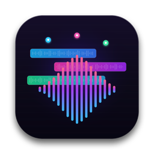

<p align="center">
  
</p>

<h1 align="center">Music Mix Studio</h1>

<p align="center">
  A modern multi-track audio joiner and timeline editor designed for macOS with companion web playback.
</p>

<p align="center">
  
  
  
  
</p>

---

## Features

### 1. Sequential Audio Joining
- **Multi-Format Support**: Import and join MP3, WAV, M4A, AAC, FLAC, and AIFF audio files.
- **Crossfade Transitions**: Configurable transition curve (0.5s to 5.0s) between adjacent audio clips.
- **Precision Trimming**: Start and end trim handles with millisecond timecode readouts.
- **Track Reordering**: Reorder clips up or down directly in the track list.
- **Waveform Visualization**: Real-time amplitude envelopes rendered from audio sample data.

### 2. Multi-Track Overlap Mode
- **Independent Audio Lanes**: Each track is arranged on its own visual timeline lane.
- **Custom Start Offsets**: Position clips anywhere on the time axis to play simultaneously or partially overlap.
- **Interactive Dragging**: Drag audio clip blocks horizontally across timeline lanes.
- **Fade In & Fade Out**: Per-track fade envelopes to avoid clipping when layering tracks.
- **Mute & Solo Controls**: Solo specific layers or mute tracks during playback.
- **Alignment Presets**: Quick actions to align to zero, stagger tracks (2s / 4s steps), or snap sequentially.

### 3. Native macOS Architecture
- **Frameworks**: SwiftUI + AVFoundation (`AVMutableComposition`, `AVAudioMix`, `AVAssetExportSession`, `AVAssetWriter`).
- **Export Formats**:
  - **M4A (AAC)**: High efficiency 256 kbps output.
  - **WAV**: Uncompressed 16-bit 44.1 kHz PCM audio.
  - **AIFF**: Uncompressed Apple Audio Interchange Format.
- **macOS Integration**: Native file open/save dialogs, Finder drag-and-drop, and system keyboard shortcuts.

---

## Getting Started

### Prerequisites
- macOS 13.0 or later
- Swift 5.9+ / Xcode Command Line Tools

### Install to Applications

Run the installer script to automatically build and place the app into your Mac's `/Applications` folder:
```bash
./install.sh
```
Once installed, you can launch **Music Mix Studio** from:
- **Spotlight**: Press <kbd>Cmd</kbd> + <kbd>Space</kbd> and type `Music Mix Studio`
- **Launchpad**: Click on the app icon
- **Finder**: Open `/Applications/Music Mix Studio.app`

---

### Build and Run Locally

Compile the application bundle:
```bash
./build.sh
```

Launch the app directly from the repo:
```bash
./run.sh
```
Or open the bundle:
```bash
open MusicMixStudio.app
```

---

### Web Audio Studio

A browser-based companion editor is available in the `web/` directory:
```bash
open web/index.html
```

---

## Keyboard Shortcuts

| Shortcut | Description |
| :--- | :--- |
| <kbd>Space</kbd> | Play / Pause master audio |
| <kbd>Cmd</kbd> + <kbd>O</kbd> | Open audio file picker |
| <kbd>Cmd</kbd> + <kbd>E</kbd> | Open export dialog |
| <kbd>Cmd</kbd> + <kbd>←</kbd> | Rewind to start |

---

## Project Structure

```
.
├── assets/
│   ├── icon.png                      # App icon (256x256)
│   ├── icon_512.png                  # App icon (512x512)
│   └── icon_1024.png                 # Master icon (1024x1024)
├── AppIcon.icns                      # macOS application icon bundle
├── Sources/
│   ├── Models/
│   │   ├── AudioTrack.swift          # Track data model
│   │   └── MergeMode.swift           # Mode definitions & format options
│   ├── AudioEngine/
│   │   ├── AudioCompositionBuilder.swift # Multi-track composition builder
│   │   ├── AudioPlayerController.swift   # AVPlayer playback controller
│   │   ├── AudioExporter.swift       # M4A and WAV export routines
│   │   └── WaveformGenerator.swift   # Sample-based waveform extractor
│   ├── Views/
│   │   ├── ContentView.swift         # Main window view
│   │   ├── TimelineView.swift        # Timeline and clip lane components
│   │   ├── TrackRowView.swift        # Individual track card
│   │   ├── TransportBarView.swift    # Transport controls and scrubber
│   │   ├── ExportSheetView.swift     # Export configuration sheet
│   │   └── SequentialTrackListView.swift # Sequential track list
│   ├── Utilities/
│   │   ├── DemoAudioGenerator.swift  # Audio stem synthesizer
│   │   └── TimeFormatter.swift       # Timecode formatting utilities
│   └── main.swift                    # Application entry point
├── web/                              # Web Audio companion application
│   ├── icon.png                      # Web favicon and logo
│   ├── index.html
│   ├── style.css
│   └── app.js
├── Info.plist                        # macOS app metadata
├── build.sh                          # Compilation script
├── run.sh                            # Launch helper
└── README.md                         # Documentation
```
